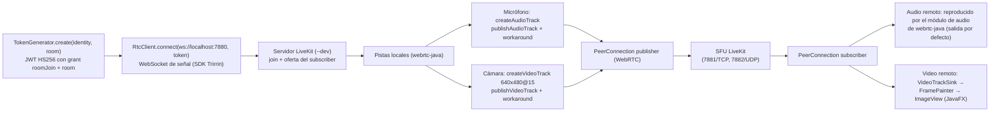

# REPORT — PoC de voz y video JavaFX contra LiveKit (Sonimbus)

> Estado: niveles -1 a 4 y Extra ejecutados (2026-09-21, 2026-10-04 y 2026-11-18). Todo corrió en UNA sola máquina
> Linux y contra localhost. Cada resultado apunta a un archivo de `evidence/`; las citas `archivo:línea` de código
> son de este repositorio, salvo las de `.refs/livekit-java-sdk/` (clon local del SDK en el commit `0fa2340`, ignorado
> por git: se recrea con `git clone` + `git checkout 0fa2340`). **Hecho verificado** = visto en un log, una
> medida o el código; **hipótesis** = explicación plausible sin comprobar. Lo que no se probó está dicho como tal.

## 1. Resumen ejecutivo

- **Audio: sí se puede.** Un cliente Java 21 + JavaFX entró en una sala de un LiveKit autoalojado, publicó el
  micrófono y reprodujo el audio remoto. Se oyó en ambos sentidos contra el cliente web oficial, con ~92 ms
  (JavaFX → navegador) y ~159 ms (navegador → JavaFX) de retardo medido y un corte de red de ~13 s recuperado
  solo (sección 5).
- **Video de cámara: sí se puede.** La ventana JavaFX publica la cámara (VP8, 640x480) y pinta el video remoto;
  el usuario confirmó que la imagen se ve correcta en ambos sentidos con el navegador (sección 6).
- **Pantalla compartida: se recibe, no se publica.** JavaFX recibe y pinta una pantalla compartida desde el navegador
  (1852x910, VP8, ~1 fps; 6.5). Capturarla y publicarla desde Java **no se logró**: el SDK no la expone y la captura de
  webrtc-java devolvió `ERROR_TEMPORARY` en las 50 pruebas en una sesión Wayland (6.4). La causa no está determinada.
- **Con qué:** `webrtc-java` 0.18.0 (medios) + el SDK comunitario `Trirrin/livekit-java-sdk` v0.1.4 (señalización).
  `webrtc-java` se comportó bien; el SDK comunitario es el punto débil: hacen falta workarounds para publicar
  (audio y video) y para cerrar sin que la JVM muera (sección 7).
- **Defecto más grave, con causa identificada en una parte:** el cierre a veces **aborta en código nativo o se queda
  colgado**: 4 de 7 sesiones largas con audio en el entorno anterior y **1 de 2 procesos en Ubuntu 26.04** (colgado
  ~15 min y luego `exit=134`); con **video** aborta en ~10 % de las sesiones de 8 s (`Pure virtual function called!`).
  **Causa del aborto con video: `PeerConnectionEngine.close()` del SDK se ejecuta dos veces a la vez** (desde el hilo que cierra y
  desde el hilo del WebSocket al llegar el `leave` del servidor). **Un parche de esa sola clase lo elimina en las pruebas: 0 de 60 con parche
  frente a 4 de 30 sin él (p = 0,011)** (7.4). **En sesiones largas de audio (2 clientes, 630 s, 12 procesos por brazo) el parche tuvo 0 fallos en 12 procesos y el SDK original 5 (3 cuelgues en `disposeInternal`, 1 SIGSEGV y 1 aborto por corrupción de heap en el cierre; Fisher unilateral p = 0,019). La muestra sigue siendo pequeña.**
- **El entorno cambió entre niveles:** los niveles 0 a 3 corrieron en Ubuntu 24.04 / PipeWire 1.0.5 / Maven 3.8.7
  y el Nivel 4 en Ubuntu 26.04.1 / PipeWire 1.6.2 / Maven 3.9.12 (3.1). De los niveles 0 a 3 solo se repitió el 3f
  en el entorno nuevo (el fallo de cierre se reproduce); el resto no.
- **No se probó:** red real (todo en localhost), cortes de más de ~13 s, Windows y macOS (solo disponibilidad de
  natives), calidad de la cancelación de eco y supresión de ruido, CPU/RAM de la ventana recibiendo video.
- **Recomendación:** A (webrtc-java + SDK comunitario en JavaFX) para voz y cámara, **condicionada** a adoptar el
  SDK como código propio (el parche del cierre es pequeño; 0 fallos en 60 cierres cortos y en 12 procesos largos, frente a 4/30 y 5/12 sin él)
  y a repetir las sesiones largas con más muestra; la pantalla compartida necesita otra vía
  (sección 9).

## 2. Objetivo y alcance

El objetivo es saber con evidencia si un cliente de escritorio Java 21 + JavaFX puede participar en una llamada
WebRTC contra un SFU LiveKit autoalojado, dado que LiveKit no tiene SDK oficial para Java de escritorio. La PoC
es desechable; este informe es el entregable, no un producto.

**Qué se probó**

- **Audio** (niveles 0 a 3): micrófono, reproducción, silencio, latencia, robustez, interoperabilidad con navegador.
- **Video de cámara** (nivel 4a a 4c): publicar la cámara desde JavaFX, recibir y pintar video remoto.
- **Pantalla** (4d y 4e): recibir una pantalla compartida en JavaFX (6.5) y un intento de captura local desde Java, que falló; no se llegó a publicarla (6.4).

**Qué no se probó:** red real, NAT/TURN, TLS (`wss`), Windows y macOS, más de dos participantes con video,
video durante más de unos minutos, cierre tras sesiones largas con video, grabación, cifrado E2E, móvil.

### 2.1 Resultados por nivel

Valores: pasa / falla / parcial / no probado.

| Nivel | Criterio | Resultado | Evidencia (en `evidence/`) |
|---|---|---|---|
| -1 Preflight | Java 21, Maven, Docker sin sudo, audio, permisos, Maven Central y JitPack | pasa (hay que exportar JAVA_HOME a Java 21 si el sistema trae otro) | `nivel-1-java-maven-20260921.txt`, `nivel-1-java21-export-20260921.txt`, `nivel-1-docker-20260921.txt`, `nivel-1-audio-20260921.txt`, `nivel-1-mic-permisos-20260921.txt`, `nivel-1-red-20260921.txt` |
| 0 Servidor | LiveKit en Docker en modo dev; dos pestañas se oyen | pasa | `nivel0-servidor-arranque-20260921.txt`, `nivel0-observacion-usuario-20260921.txt` |
| 1 webrtc-java solo | Listar dispositivos, capturar micrófono, loopback con dos PeerConnection; se oye | pasa (se oyó por altavoces, sin eco percibido; supresión de ruido sin evaluar) | `nivel1-loopback-tecnico-20261004.txt`, `nivel1-observacion-usuario-20261004.txt` |
| 2 JavaFX + SDK | Ventana, tokens, publica micrófono y reproduce audio remoto | pasa, con dos workarounds sobre el SDK (7.1, 7.2) | `nivel2-observacion-usuario-20261004.txt` (3), `nivel2-cliente-javafx-1-20261004-092228.txt`, `nivel2-servidor-prueba-audible-20261004.txt` |
| 3a / 3b | JavaFX habla y el navegador oye / al revés | pasa | `nivel2-observacion-usuario-20261004.txt` (3), `nivel2-servidor-prueba-audible-20261004.txt` |
| 3c | Silenciar/reactivar se refleja en ambos lados | pasa | `nivel3-observacion-usuario-20261004.txt` (1), `nivel2-cliente-javafx-1-20261004-092228.txt` |
| 3d | Entradas/salidas de participantes | parcial: las normales bien; si el servidor expulsa al cliente (identidad duplicada) este queda colgado (7.3) | `nivel3d-entradas-salidas-identidad-duplicada-20261004.txt` |
| 3e | Cortar la red 10 s | pasa para un corte de ~13 s (IPv4 + IPv6): vuelve solo; la ventana no avisa. Cortes más largos sin probar | `nivel3e-corte-red-total-20261004.txt`, `nivel3e-corte-red-20261004.txt` (primer intento no concluyente) |
| 3f | 10 min sin caídas ni fugas | parcial: dos corridas de 10 min 29 s sin caídas y memoria plana (RSS +0,3 %); **pero 4 de 7 sesiones largas fallaron al cerrar** (7.4). **Repetido en Ubuntu 26.04 (2026-11-18): 1 de 2 procesos colgado ~15 min en `disposeInternal` y luego `exit=134`**; memoria plana. **Segunda ronda con captura de pila:** con `gdb` enganchado, 2audio, 1audio y video cerraron limpios (630 s); en modo `late` (sin `gdb` hasta el cuelgue) el primer 2audio colgó 1 de 2 y se capturó la pila nativa (7.4) | `nivel3f-investigacion-cierre-20261004.txt`, `nivel3f-10min-memoria-20261004.txt`, `nivel3f-salida-sin-jcmd-20261004.txt`, `nivel3f-caida-al-salir-ventana-20261004.txt`, `nivel3f-repeticion-ubuntu2604-20261118.txt`, `nivel3f-repeticion-ubuntu2604-hilos-soakb-20261118.txt`, `nivel3f-soak2-*-20261118-*.txt` |
| 3g | Latencia < 400 ms en red local | pasa en la misma máquina: ~92 ms y ~159 ms, RTT 1–2 ms (con una corrección de 75 ms medida aparte) | `nivel3g-retardo-javafx-navegador-20261004.txt`, `nivel3g-retardo-navegador-javafx-20261004.txt` |
| 3h | Dos JavaFX + un navegador | pasa (2 corridas, 0 pérdidas; el usuario confirma que se oían los tres) | `nivel3h-dos-javafx-navegador-2-20261004.txt`, `nivel3-observacion-usuario-20261004.txt` (4), `nivel3h-dos-javafx-navegador-20261004.txt` |
| Extra | Natives para Windows y macOS (solo disponibilidad) | disponibles en Maven Central; no ejecutados | `extra-natives-windows-macos-20261004.txt` |
| 4a | Publicar la cámara desde un cliente Java | pasa: VP8 640x480, ~1,22 Mbit/s, 0 perdidos; **necesita el mismo workaround que el audio** | `nivel4a-camara-publicar-20261118.txt` |
| 4b | Recibir y pintar video remoto en JavaFX | pasa (usuario: "se ve de manera correcta"); 5–8 fps, limitados por el origen | `nivel4-observacion-usuario-20261118.txt`, `nivel4-cliente-javafx-video-20261118-124554.txt`, `nivel4bc-servidor-estadisticas-20261118.txt` |
| 4c | Ventana JavaFX con vista previa local y video remoto | pasa (misma observación) | `nivel4-cliente-javafx-video-20261118-124200.txt`, `nivel4-observacion-usuario-20261118.txt` |
| 4d | Compartir pantalla (opcional) | **falla** en Wayland: 50 de 50 capturas `ERROR_TEMPORARY`; el SDK no la expone | `nivel4d-pantalla-captura-wayland-20261118.txt` |
| 4e | Recibir una pantalla compartida desde el navegador en JavaFX (añadido) | pasa: pista `SCREEN_SHARE` VP8 1852x910, ~1 fps, 0 perdidos, 0 descartados; el usuario: "en efecto recibe la pantalla compartida" | `nivel4e-recibir-pantalla-navegador-20261118.txt`, `nivel4-cliente-javafx-video-1-20261118-140150.txt`, `nivel4-cliente-javafx-video-1-20261118-141352.txt` |
| 4f | Cierre limpio con video (añadido) | **parcial/falla sin parche:** 3 de 30 cierres de 8 s con video abortan (`Pure virtual function called!`); **con el parche de `close()`: 0 de 60** frente a 4 de 30 sin él en el mismo experimento (Fisher p = 0,011) | `nivel3f-cierre-corto-video-plain-20261118-205435-resumen.txt`, `nivel3f-cierre-corto-AB-parche-close-20261118.txt`, `nivel3f-soak2-AB-largo-20261118.txt` (audio largo: 0/12 vs 5/12), `nivel3f-cierre-corto-video-plain-parche1-*`, `-original-*`, `-parche2-*`, `nivel3f-cierre-corto-video-gdb-20261118-205846-gdb-run3.txt` |
| 4 medidas | CPU, memoria, ancho de banda | parcial: medido el cliente publicando sin ventana; sin medir la ventana recibiendo | `nivel4-medidas-cpu-memoria-20261118.txt` |

## 3. Entorno

### 3.1 Versiones

| Componente | Versión | Evidencia |
|---|---|---|
| Sistema operativo | **Niveles 0–3: Ubuntu 24.04**, kernel 7.0.0-31-generic. **Nivel 4: Ubuntu 26.04.1 LTS**, kernel 7.0.0-38-generic. Sesión X11 en los niveles 0–3 y **Wayland (GNOME)** en el Nivel 4 | `nivel-1-java-maven-20260921.txt`, `nivel-1-mic-permisos-20260921.txt`, `nivel4-entorno-20261118.txt` |
| Java (JDK) | OpenJDK 21 (`/usr/lib/jvm/java-21-openjdk-amd64`, fijado con `env.sh`; 21.0.13 en el Nivel 4). El sistema puede traer otro JDK por defecto | `nivel-1-java21-export-20260921.txt`, `nivel4-entorno-20261118.txt` |
| Maven | 3.8.7 (niveles 0–3); 3.9.12 (Nivel 4) | `nivel-1-java-maven-20260921.txt`, `nivel4-entorno-20261118.txt` |
| Docker / Compose | 29.1.3 / 2.40.3, sin sudo (grupo `docker`) | `nivel-1-docker-20260921.txt`, `nivel4-entorno-20261118.txt` |
| Servidor de audio | PipeWire 1.0.5 (niveles 0–3) y 1.6.2 (Nivel 4) con WirePlumber; las aplicaciones entran por la capa PulseAudio | `nivel-1-audio-20260921.txt`, `nivel4-entorno-20261118.txt` |
| livekit/livekit-server (imagen) | v1.13.7, `--dev --bind 0.0.0.0`, `network_mode: host` | `nivel0-verificacion-versiones-20260921.txt`, `nivel0-servidor-arranque-20260921.txt`, `nivel4-entorno-20261118.txt` |
| dev.onvoid.webrtc:webrtc-java | 0.18.0 (nativo linux-x86_64; `pom.xml:15`). El SDK comunitario fija 0.14.0; Maven resuelve 0.18.0 | `nivel1-dependencias-20261004.txt`, `nivel2-problemas-sdk-20261004.txt` (E) |
| JavaFX | javafx-controls 21.0.8 (`pom.xml:16`) | `nivel2-dependencias-tamano-20261004.txt` |
| SDK comunitario Trirrin/livekit-java-sdk (`rtc`) | tag v0.1.4 vía JitPack (`pom.xml:17`), commit `0fa2340` (2025-12-06). Envía protocolo de señal 13 | `nivel2-problemas-sdk-20261004.txt` (A), `nivel4-entorno-20261118.txt` |
| io.livekit:livekit-server (tokens) | 0.16.0 (`pom.xml:18`) | `nivel0-verificacion-versiones-20260921.txt`, `nivel2-dependencias-tamano-20261004.txt` |
| Navegador de las pruebas | Brave, con https://meet.livekit.io en modo Custom. Versión no registrada | `nivel-1-audio-20260921.txt` |
| Cámara (Nivel 4) | webcam USB "USB2.0 HD UVC WebCam"; `/dev/video0` y `/dev/video1` accesibles sin sudo | `nivel4-entorno-20261118.txt`, `nivel4a-camara-publicar-20261118.txt` |

Nota: el sistema operativo, PipeWire y Maven cambiaron entre las sesiones de los niveles 0–3 y la del Nivel 4. Los
resultados de audio no se repitieron en el entorno nuevo, salvo el 3f (el fallo de cierre se reproduce, 7.4) y lo que el
Nivel 4 reutiliza: `webrtc-java`, el SDK y la conexión al servidor.

### 3.2 Cómo se levantó el servidor

`docker-compose.yml:6-9`: imagen `livekit/livekit-server:v1.13.7`, `command: --dev --bind 0.0.0.0`,
`network_mode: host`, `restart: "no"`. Se arranca con `docker compose up -d`.

- **Puertos reales (hecho):** el arranque registra `portHttp: 7880`, `rtc.portTCP: 7881`, `rtc.portUDP: {Start: 7882,
  End: 0}`: es decir **7880/TCP (señal), 7881/TCP (ICE/TCP) y un único puerto UDP 7882**, no el rango 50000–60000
  (`nivel0-servidor-arranque-20260921.txt:4`). El comentario de `docker-compose.yml:2` menciona 50000–60000: es el
  valor de la guía oficial para un despliegue sin `--dev`, no el que usó la PoC.
- **Modo dev:** la clave y el secreto son los fijos de `--dev` (en el repo: `TokenGenerator.java:10-11` y
  `tools/token.py:6,8`; en este informe: `change_this_dev_key` / `change_this_dev_secret`). No sirven fuera de pruebas.
- **No sobrevive a un reinicio** (`restart: "no"`): tras reiniciar la máquina hay que repetir `docker compose up -d`;
  si no, el cliente falla con `ConnectException: Connection refused`
  (`nivel4-cliente-javafx-video-1-20261118-134402.txt`).
- El servidor escucha en 0.0.0.0, pero la PoC solo usó `localhost`.

### 3.3 Particularidades de Linux

- **Audio:** webrtc-java entra por la capa PulseAudio de PipeWire y ve 1 micrófono y 1 salida; usa las del sistema
  por defecto, y el SDK no permite elegir dispositivo de forma efectiva (7.5). Varios programas pueden abrir el mismo
  micrófono a la vez (`nivel2-servidor-audio-bidireccional-20261004.txt`). La caída del 7.4 ocurre dentro del cliente
  nativo de PulseAudio (`nivel3f-investigacion-cierre-20261004.txt`).
- **Permisos de micrófono:** no hizo falta ninguno ni apareció diálogo; el micrófono estaba silenciado y al 22 % y
  hubo que activarlo a mano (`nivel-1-mic-permisos-20260921.txt`, `nivel0-observacion-usuario-20260921.txt`).
- **Cámara:** accesible sin permisos extra ni diálogo. Una sola cámara física: JavaFX y el navegador se probaron por
  turnos; **no se probó** abrirla desde dos procesos a la vez.
- **Pantalla en Wayland:** ver 6.4.
- **Partición NTFS (ntfs3):** permisos emulados (`bash script.sh`). El kernel registró dos `kernel BUG at
  fs/iomap/buffered-io.c:1061` en `ntfs_file_write_iter` (2026-10-04 09:53:21 y 10:24:33) escribiendo en `evidence/`;
  uno mató al proceso `tee` de un log y dejó un archivo bloqueado en estado `D`, que quedó legible tras reiniciar
  (`nivel3f-investigacion-cierre-20261004.txt`). Es un problema del driver, no de la PoC; conviene mover el
  proyecto a ext4. `run-nivel4.sh` escribe el log fuera de NTFS y lo copia al final por esa razón.

### 3.4 Tamaño y dependencias

| Elemento | Valor | Evidencia |
|---|---|---|
| JARs | 41 en el classpath, 38 552 KiB (~37,6 MiB), solo linux-x86_64. Mayores: webrtc-java nativo 9,4 MiB, `protocol` del SDK 4,6 MiB, javafx-graphics 4,5 MiB, livekit-server 4,0 MiB | `nivel2-dependencias-tamano-20261004.txt` |
| Natives por plataforma | webrtc-java 0.18.0: linux-x86_64 9,4 MiB, windows-x86_64 8,3, windows-aarch64 7,1, macos-x86_64 7,4, macos-aarch64 6,3. JavaFX 21.0.8 no publica linux-aarch64 | `extra-natives-windows-macos-20261004.txt` |
| Librerías del sistema | libx11-6, libxext6, libxfixes3, libxdamage1, libxtst6, libxrandr2, libxcomposite1, libglib2.0-0t64, libgbm1, libdrm2, libpulse0 (todas ya instaladas) | `nivel1-libs-sistema-20260921.txt` |
| Artefacto distribuible | No se construyó (ni fat-jar ni instalador); se ejecuta con `mvn exec:java`. Los JARs de arriba son la cifra de referencia | — |

## 4. Arquitectura de la PoC

### 4.1 Flujo token → conexión → pistas



Piezas de código (todas en `src/main/java/sonimbus/poc/`):

| Pieza | Archivo | Papel |
|---|---|---|
| Token | `level2/TokenGenerator.java` | genera el JWT con el SDK oficial `io.livekit:livekit-server` |
| Cliente de voz | `level2/VoiceClient.java` | conecta, publica micrófono, silencia, sale (sin JavaFX) |
| Ventana de voz | `level2/VoiceApp.java`, `Launcher.java` | URL, sala, identidad, Conectar/Salir, Silenciar, participantes, log |
| Cliente de video | `level4/VideoClient.java` | conecta, publica cámara, sink de video remoto y local |
| Pintado | `level4/FramePainter.java` | convierte I420 a BGRA y pinta en un `ImageView` |
| Ventana de video | `level4/VideoApp.java`, `VideoLauncher.java` | vista previa local, video remoto, fps |
| Parche del SDK (experimental) | `io/livekit/sdk/rtc/PeerConnectionEngine.java` | copia modificada de la clase del SDK (Apache-2.0): `close()` serializado e idempotente; sustituye a la del JAR (7.4) |
| Mitigación (experimental, apagada) | `level4/CierreSeguro.java` | vigilante que termina el proceso si un paso del cierre se bloquea (`-Dpoc.cierreSeguroMs=N`; 7.4) |
| Sondas | `level1/Level1Loopback.java`, `level2/HeadlessCheck.java`, `level4/VideoHeadless.java`, `level4/ScreenProbe.java` | pruebas sin ventana |

### 4.2 El token y sus grants

`TokenGenerator.create` (`TokenGenerator.java:15-21`) crea un `AccessToken` con la clave de desarrollo, fija
identidad y nombre, y añade **solo dos grants: `RoomJoin(true)` y `RoomName(room)`** (línea 19). El servidor registró
el grant tal cual: `"Video": {"RoomJoin": true, "Room": "poc", "CanPublish": "not-set", "CanSubscribe": "not-set",
"CanPublishData": "not-set", "CanPublishSources": [] …}` (`nivel2-headless-20261004.txt:68`).

- **Sala:** la indicada en el token (`poc` por defecto).
- **Publicar y suscribir:** el token **no los fija** (`not-set`); el permiso viene del valor por defecto del
  servidor, que respondió `"permission": {"canSubscribe": true, "canPublish": true, "canPublishData": true}`
  (`nivel2-headless-20261004.txt:49`).
- **Fuentes permitidas:** el token no usa `canPublishSources` (lista vacía). Hecho: con ese token se publicó
  **micrófono** (`nivel2-headless-2-20261004.txt`) y **cámara** (`nivel4a-camara-publicar-20261118.txt`). **No
  verificado:** que una lista vacía permita también la **pantalla**, porque no se llegó a publicarla.
- **Para un uso real**, el token debe generarlo un backend con la clave real, fijar `canPublish`, `canSubscribe` y
  `canPublishSources` explícitos y caducar pronto (el actual dura 6 h: `nivel2-headless-20261004.txt:68`,
  `TokenExpiresAt`).
- `tools/token.py` genera el token del navegador con las mismas dos claves de grant (`tools/token.py:7`).

## 5. Audio

**Qué funciona (hechos)**

- Publicar el micrófono desde JavaFX y que el navegador lo oiga; recibir y reproducir el audio del navegador;
  silenciar y reactivar con reflejo en ambos lados; entradas y salidas de participantes; tres participantes a la
  vez (2 JavaFX + 1 navegador). Ver la tabla 2.1 (niveles 2 y 3).
- Retardo ~92 ms (JavaFX → navegador) y ~159 ms (navegador → JavaFX) en la misma máquina, RTT 1–2 ms.
- Corte total de red de ~13 s recuperado solo, con el mismo participante y pista; se pierde solo el audio del corte.
- Memoria plana en 10 min 29 s (RSS +0,3 %).

**Cómo se publica el micrófono:** `VoiceClient.publishMicrophone` (`VoiceClient.java:65-80`) llama a
`client.createAudioTrack()` (el SDK crea un `AudioDeviceModule` de webrtc-java y toma el micrófono por defecto:
`MediaDevicesHelper.java:93-115`), luego a `client.publishAudioTrack(micTrack)` y **fuerza la oferta del publisher**
con `client.onPublisherNegotiationNeeded()` (`VoiceClient.java:78`), workaround obligatorio (7.1).

**Cómo se reproduce el audio remoto:** la aplicación no escribe ningún código de reproducción: el módulo de audio de
webrtc-java reproduce por la salida por defecto del sistema las pistas remotas suscritas
(`nivel1-loopback-tecnico-20261004.txt`; en el Nivel 2 el usuario confirma que se oye en
`nivel2-observacion-usuario-20261004.txt` (3)). **Hipótesis:** el mecanismo interno exacto (qué `AudioDeviceModule`
reproduce) no se auditó en el código nativo.

**Qué no funciona o no se evaluó:** elegir dispositivo (7.5), configurar cancelación de eco y supresión de ruido en
el SDK (en el Nivel 1, con webrtc-java directo y opciones activadas, el usuario no percibió eco por altavoces;
supresión de ruido sin evaluar), estadísticas del cliente (RTT y jitter salieron del servidor).

## 6. Video

Código: `level4/VideoClient.java`, `FramePainter.java`, `VideoApp.java`. Resultados: `nivel4*-20261118.txt`.

### 6.1 Captura y publicación de la cámara

- **Librería de captura:** `webrtc-java` 0.18.0 (`dev.onvoid.webrtc.media.video.VideoDeviceSource`, sobre V4L2),
  creada por el SDK en `MediaDevicesHelper.createVideoTrack`
  (`.refs/livekit-java-sdk/rtc/src/main/java/io/livekit/sdk/rtc/MediaDevicesHelper.java:134-164`).
  No se usó ninguna otra librería de captura.
- **Resolución y fps pedidos:** 640x480 a 15 fps (`VideoApp.java:68`, `VideoHeadless` por defecto); también se
  midió 1280x720 a 30 fps, que es el valor por defecto del SDK (`MediaDevicesHelper.java:122`).
- **Códec (hecho):** **VP8**. El SDK no fija ningún códec (no hay referencias a códec en su `rtc`); el servidor
  ofrece VP8, H264, VP9, AV1 y H265 y registró `"mime": "video/VP8"` al publicar
  (`nivel4a-camara-publicar-20261118.txt`). Se publica **una sola capa** (sin simulcast): el servidor ve `layer 0` del
  cliente JavaFX, mientras el navegador publica 3 capas (`nivel4bc-servidor-estadisticas-20261118.txt`).
- **Cómo se publicó la pista:** `client.createVideoTrack(null, "camera", w, h, fps)` → `client.publishVideoTrack(track)`
  (envía `AddTrackRequest` con fuente `CAMERA` y añade la pista al publisher PeerConnection:
  `RtcClient.java:97-112`) → `client.onPublisherNegotiationNeeded()` (`VideoClient.java:99-100`). **Sin ese último
  paso el servidor solo registra `pending track added` y nunca `mediaTrack published` ni RTP** (comprobado con
  `-Dpoc.sinforzar=true`, `nivel4a-camara-publicar-20261118.txt`, sección B).
- **Apagar la cámara:** `RtcClient.setCameraEnabled` silencia la pista y avisa al servidor (`RtcClient.java:603-612`,
  `LocalVideoTrack.java:56-60`); **no se verificó** si la fuente de captura sigue abierta (7.6).

### 6.2 Recibir y pintar frames en JavaFX

1. El SDK entrega la pista remota en `onTrackSubscribed` como `RemoteVideoTrack`; `VideoClient` le añade un
   `VideoTrackSink` (`VideoClient.java:167-179`), que cuenta fotogramas y resolución y llama al receptor.
2. `FramePainter.accept` (`FramePainter.java:36-52`) corre en el hilo nativo: convierte el fotograma I420 a un
   `byte[]` BGRA con `VideoBufferConverter.convertFromI420(..., FourCC.ARGB)` (línea 42), porque el fotograma solo es
   válido durante la llamada. `FourCC.ARGB` de libyuv son bytes B,G,R,A en memoria, que es lo que espera
   `PixelFormat.getByteBgraInstance()`.
3. Pide **un único** repintado pendiente con `Platform.runLater` (`compareAndSet`, líneas 49-54); si la UI va
   atrasada, descarta fotogramas intermedios y los cuenta.
4. En la FX thread, `paint()` copia el búfer a un `WritableImage` con `PixelWriter.setPixels` (línea 64). La
   resolución puede cambiar en vivo (se vio 384x216 → 1280x720).
5. La vista previa local usa el mismo mecanismo con un sink sobre la pista nativa local
   (`VideoClient.java:89-96`).

**Hecho:** el usuario confirmó que la imagen se ve correcta en ambos sentidos
(`nivel4-observacion-usuario-20261118.txt`: *"si la ventana de javafx transmite de manera correcta la imagen ya hice
ambas pruebas y se ve de manera correcta"*). La respuesta no detalla colores ni fluidez. Las pruebas fueron por
turnos (una sola cámara).

### 6.3 Medidas

Todas en `nivel4-medidas-cpu-memoria-20261118.txt` y `nivel4bc-servidor-estadisticas-20261118.txt`.

| Medida | Valor | Condición |
|---|---|---|
| Ancho de banda subida (VP8) | ~1,66 Mbit/s medio (28,6 MB en 2 min 17 s, 0 perdidos) | ventana JavaFX, 640x480@15 pedidos |
| Ancho de banda subida, 640x480@15 | ~1,48 Mbit/s | cliente sin ventana, 44 s |
| Ancho de banda subida, 1280x720@30 | ~1,79 Mbit/s | cliente sin ventana, 44 s |
| Ancho de banda bajada (video del navegador) | ~1,52 Mbit/s, 0 perdidos | una capa de 3 simulcast, 20 s |
| CPU del cliente publicando, 640x480 | ~12–16 % de un núcleo (máquina de 16 hilos) | sin ventana, no incluye pintado |
| CPU del cliente publicando, 1280x720 | ~34 % de un núcleo tras estabilizarse (11–22 % al inicio) | sin ventana |
| RSS | 147 MiB (640x480), 188 MiB (1280x720) | sin ventana |
| FPS reales | **7–8 fps** al servidor (y 12,7 fps medios en la ventana, 2 min) aunque se piden 15 o 30 | ver abajo |
| FPS pintados en JavaFX | 5–8 fps, = recibidos, 0 descartados | prueba B, 4 muestras |

- **Hecho:** la webcam entrega solo ~7,3 fps a 640x480 y ~7,8 fps a 1280x720 aunque se pidan 30, medido con
  `ffmpeg` sin webrtc-java. El límite está en la cámara/driver/entorno, no en la librería ni en el pintado.
- **Hipótesis:** exposición automática con poca luz. No se probó con más luz ni con otra cámara.
- **No medido:** CPU y memoria de la **ventana JavaFX** recibiendo y pintando video, latencia del video, varios
  participantes con video, sesiones largas con video. Los 12,7 fps medios de la ventana (frente a ~7,4 del cliente sin
  ventana) no se explican con estos datos: pueden deberse a la luz del momento (hipótesis).

### 6.4 Capturar y publicar pantalla desde Java: no funciona (hecho) y causa por determinar

- **El SDK no la expone:** `setScreenShareEnabled` está vacío ("not yet implemented", `RtcClient.java:619-622`) y el
  README lo dice (`.refs/livekit-java-sdk/README.md:182`, `TODOS.md:48`). Publicarla exigiría enviar nuestro
  `AddTrackRequest` con fuente `SCREEN_SHARE` y crear la pista con el `PeerConnectionFactory` del SDK, que es un campo
  privado (`PeerConnectionEngine.java:16`): haría falta tocar el SDK o usar reflexión. No se intentó.
- **La captura local falla en esta sesión:** `ScreenCapturer` enumera 1 pantalla y `WindowCapturer` 1 ventana, ambas
  con `title=null`, pero **50 de 50 capturas devolvieron `ERROR_TEMPORARY` sin fotograma**
  (`nivel4d-pantalla-captura-wayland-20261118.txt`, sonda `ScreenProbe.java`). Sesión GNOME/Wayland, `DISPLAY=:0` de
  Xwayland.
- **Otro detalle (hecho):** `ScreenCapturer` lanza `UnsatisfiedLinkError` si antes no se creó un
  `PeerConnectionFactory` (que es lo que carga la biblioteca nativa).
- **Hipótesis (no verificada):** en Wayland el backend X11 solo ve Xwayland y no la pantalla real, y la captura
  nativa vía portal/PipeWire necesita un diálogo de GNOME o una API del wrapper Java que no se usó. El nativo sí
  contiene cadenas de `org.freedesktop.portal.ScreenCast` y `libpipewire-0.3.so.0`, y los portales
  `xdg-desktop-portal-gnome` están instalados.
- **No probado:** captura bajo sesión X11 (Ubuntu on Xorg), si apareció algún diálogo del portal (en la medición de las 50 capturas no se estaba
  mirando la pantalla; en una repetición posterior el usuario sí vio el diálogo del portal de GNOME, `nivel4d-observacion-usuario-portal-20261119.txt`, pero no se registró el resultado tras aceptarlo), ni la publicación de una pista de pantalla. `run-nivel4d.sh` permite repetir la sonda viendo
  la pantalla.

### 6.5 Recibir una pantalla compartida: funciona (4e)

- **Hecho:** con el navegador compartiendo pantalla, la ventana JavaFX recibió la pista como `RemoteVideoTrack` y la
  pintó con el mismo `FramePainter` que la cámara: `[stats] remoto: recibidos 1 fps, pintados 1 fps, descartados 0,
  1852x910`. El servidor la registra con `"source": "SCREEN_SHARE"`, VP8, capas 926x455 y 1852x910, sin pérdidas
  (`nivel4e-recibir-pantalla-navegador-20261118.txt`).
- **Observación del usuario (literal):** *"en efecto recibe la pantalla compartida, pero el fallo es del 4d"*. No detalla
  la nitidez de la imagen.
- **Medidas (servidor):** ~10–27 kbit/s y 1–1,6 fps. **Hipótesis:** el fps bajo se debe a que el contenido compartido era
  casi estático; no se probó con contenido en movimiento. CPU y memoria de esta recepción: no medidas.
- **Alcance:** las pruebas se hicieron en la sala `poc` y la segunda coincidió con los clientes `soak-a` y `soak-b`, lo
  que no afecta a esta conclusión pero obligó a repetir el soak (7.4).

## 7. Defectos encontrados

Convención: **parche** = hay corrección en el código de la PoC; **workaround** = se rodea sin arreglar la causa;
**sin parche** = reproducido y no corregido.

### 7.1 La pista no se publica: el SDK nunca envía la oferta del publisher (audio y video)

- **Síntoma:** el cliente dice "publicado", el servidor se queda en `pending track added` y nunca aparece
  `mediaTrack published`; sin error visible.
- **Reproducir:** audio: quitar la línea `VoiceClient.java:78` (`nivel2-headless-20261004.txt`). Video:
  `java -Dpoc.sinforzar=true … VideoHeadless` (`nivel4a-camara-publicar-20261118.txt`, B).
- **Causa (leída en el código del SDK, hecho):** el evento "negotiation needed" se consume al crear los data
  channels, antes de haber pistas, y `RtcClient.onPublisherNegotiationNeeded()` lo ignora; no se repite al añadir la
  pista.
- **Parche:** workaround en `VoiceClient.java:78` y `VideoClient.java:99-100`. Evidencia: `nivel2-problemas-sdk-20261004.txt`
  (B), `nivel2-headless-2-20261004.txt`, `nivel4a-camara-publicar-20261118.txt`.

### 7.2 Caída nativa (SIGSEGV) al salir por un orden de cierre incorrecto

- **Síntoma:** `SIGSEGV (0xb) at pc=0x00007275d5c598c6 … C [libwebrtc-java-linux-x86_64….so+0x6598c6]`; la JVM muere
  sin excepción.
- **Reproducir:** `unpublish → shutdown → dispose` de la pista = SIGSEGV; `unpublish → dispose → shutdown` = limpio
  (`nivel2-crash-sigsegv-hs_err-20261004.log`, `nivel2-headless-20261004.txt`).
- **Causa (hecho):** disponer la pista local después de `RtcClient.shutdown()` (factory ya liberada); el SDK no libera
  la pista local en `disconnect()`.
- **Parche:** workaround, orden correcto en `VoiceClient.java:98-100` y `VideoClient.java:124-128`.
- El Nivel 1 también encontró que `AudioTrack.dispose()` lanza `java.lang.Error` si antes no se hace
  `removeTrack(sender)` (`nivel1-problema-dispose-20261004.txt`); mismo patrón.

### 7.3 El cliente expulsado por el servidor se queda colgado

- **Síntoma:** al entrar un segundo cliente con la misma identidad, el servidor expulsa al primero
  (`DUPLICATE_IDENTITY`). El expulsado solo recibe `onReconnecting`; nunca `onDisconnected`; la aplicación se cree
  conectada con la lista de participantes obsoleta. Al llamar después a `disconnect()` aparece
  `NullPointerException: Object handle is null` (el SDK ya dispuso la pista en `RtcClient.onLeave`).
- **Reproducir:** abrir dos clientes con la misma identidad (`nivel3d-entradas-salidas-identidad-duplicada-20261004.txt`).
- **Causa:** el SDK no trata el `LeaveRequest` del servidor como desconexión (comportamiento observado; el detalle
  interno es lectura del código).
- **Parche:** sin parche. Exige tocar el SDK o envolverlo.

### 7.4 Aborto o bloqueo al cerrar tras sesiones de más de ~7 minutos (intermitente, sin resolver)

- **Síntoma:** al salir tras una sesión de más de ~7 min, el proceso a veces **aborta en código nativo o se queda
  colgado**. El servidor sí recibe la salida (`CLIENT_REQUEST_LEAVE`): lo que falla es liberar el audio local. Las
  salidas de audio tras sesiones de 8 s a ~5 min fueron limpias (con **video** sí hubo abortos en sesiones de 8 s: ver más abajo).
- **Errores vistos:** `The futex facility returned an unexpected error code.` (exit=134, 2026-11-18, Ubuntu 26.04);
  `Assertion 'pa_close(fds[0]) == 0' failed at ../src/pulsecore/core-util.c:2713` (exit=134);
  `XIO: fatal IO error 0 (Success) on X server`; `SIGSEGV` en `libX11.so.6 _XReply` con
  `corrupted double-linked list`; `libc++abi: Pure virtual function called!` (exit=134); y un proceso colgado 33 min
  en la llamada nativa `AudioDeviceModuleBase.disposeInternal` (`MediaDevicesHelper.dispose` ←
  `PeerConnectionEngine.close` ← `RtcClient.disconnect`).
- **Reproducir (no determinista):** `bash tools/soak.sh 630` o dejar la ventana conectada más de ~7 minutos y pulsar
  Salir. Frecuencia en octubre (Ubuntu 24.04): de 7 sesiones largas con el SDK, **4 fallaron (7 procesos) y 3 cerraron
  limpias (6 procesos)**; entonces, dentro de una sesión fallaban todos los procesos o ninguno
  (`nivel3f-investigacion-cierre-20261004.txt:15-16`). Las 4 que fallaron fueron entre las 09:51 y las 11:42 del
  2026-10-04; las 3 limpias, entre las 11:54 y las 12:05.
- **Repetición en el entorno nuevo (2026-11-18, Ubuntu 26.04, PipeWire 1.6.2, Wayland):** `bash tools/soak.sh 630` con dos
  clientes. `soak-a` cerró limpio (`exit=0`); **`soak-b` quedó bloqueado ~15 min (14:29:42 → 14:44:59) en la misma pila**
  (`AudioDeviceModuleBase.disposeInternal` ← `MediaDevicesHelper.dispose` (`MediaDevicesHelper.java:173`) ←
  `PeerConnectionEngine.close` (`:228`) ← `RtcClient.disconnect` (`:74`)) y luego **abortó con `exit=134`**. Memoria plana
  (~205–208 MiB). Esto **desmiente** la regla "todos o ninguno" y muestra que el fallo **no depende del entorno
  anterior** (`nivel3f-repeticion-ubuntu2604-20261118.txt`, `nivel3f-repeticion-ubuntu2604-hilos-soakb-20261118.txt`).
  Una primera repetición se descartó por contaminación de la sala `poc` con otros clientes. Salvedad: ~75 s antes del
  aborto se hizo un `jcmd Thread.print` y un intento fallido de `gdb -p` sobre el proceso colgado; no se puede
  descartar que influyeran, aunque `soak.sh` ya usa `jcmd` cada 30 s y en octubre se refutó que `jcmd` lo provoque.
- **Contraste:** el loopback del Nivel 1 durante 10 min 30 s con webrtc-java solo cerró limpio
  (`nivel1-loopback-10min-cierre-20261004.txt`). Como el fallo es intermitente, una corrida limpia no exculpa a
  webrtc-java.
- **Hipótesis refutadas (hecho, cada una con una sesión de 10 min):** (1) el SDK libera demasiado pronto un
  `AudioDeviceModule` huérfano: el defecto existe, pero liberarlo al final no evitó el fallo; (2) depende de
  `mvn exec:java`: cuatro clientes con `java -cp` y Maven cerraron limpios; (3) depende del recolector de basura: no
  hubo recolección tras el arranque en 630 s; (4) lo provoca `jcmd`: falló también sin él.
- **Causa:** **sin determinar.** No se obtuvo pila nativa (la corrida bajo `gdb` no falló). **Hipótesis sin probar:**
  el estado del servidor de audio (pipewire-pulse registró desbordamientos), el uso de X11 por el módulo de audio, o
  el estado del kernel tras los fallos de ntfs3 (aunque la primera caída es anterior al primero de ellos). **Hipótesis
  nueva (no probada):** carrera entre dos `disposeInternal` simultáneos sobre el servidor de audio compartido, pues los dos
  clientes cerraron en el mismo milisegundo (14:29:42.04); no explica los fallos de octubre con un solo cliente por proceso
  en sesiones distintas.
- **Segunda ronda con `tools/soak-gdb.sh` (2026-11-18, 630 s, Ubuntu 26.04; ejecuta el usuario `sudo sysctl kernel.yama.ptrace_scope=0`
  antes):**

  | Corrida | Resultado |
  |---|---|
  | `2audio` con `gdb` enganchado 30 s antes del cierre | limpio en los dos clientes |
  | `1audio` con `gdb` | limpio |
  | `video` (cámara 640x480@15) con `gdb` | limpio (primer cierre con cámara probado a 630 s) |
  | `2audio` en modo `late` (sin `gdb` hasta que haya cuelgue), corrida 1 | `soak-b` limpio; **`soak-a` colgado** al cerrar (16:30:48) y luego `exit=134` con `The futex facility returned an unexpected error code` |

  Con `gdb` enganchado el fallo no volvió a aparecer en 3 corridas; es compatible con que `gdb` lo enmascare, pero no
  está demostrado. Evidencia: `nivel3f-soak2-*-20261118-*.txt`.
- **PILA NATIVA del cuelgue (hecho, `nivel3f-soak2-2audio-20261118-162014-gdb-soak-a.txt`):** el hilo principal de Java
  (`HeadlessCheck.main`) está dentro de `Java_dev_onvoid_webrtc_media_audio_AudioDeviceModuleBase_disposeInternal`, que llama
  a tres funciones internas de `libwebrtc-java` (sin símbolos, el binario está `stripped`) y estas a
  `__pthread_clockjoin_ex`, esperando un `futex`. **El hilo al que espera (`0x7cb8ae4f96c0`) no figura entre los 24 hilos
  vivos del proceso.** El hilo `threaded-ml` de PulseAudio sigue vivo en `pa_mainloop_run` y no es el esperado. `jcmd
  Thread.print` no pudo adjuntarse (`doesn't respond within 10s`, `nivel3f-soak2-2audio-20261118-162014-jstack-soak-a.txt`).
  **El bloqueo está dentro del código nativo de `webrtc-java`/WebRTC al destruir el módulo de audio**; el SDK lo invoca en
  `MediaDevicesHelper.java:173`, pero la causa no está en la capa de señalización.
- **Hipótesis nuevas (sin probar):** (1) `disposeInternal` hace `pthread_join` sobre un hilo ya terminado o con un
  identificador no válido (por ejemplo, una carrera entre la salida del hilo de audio y el cierre), por lo que espera un
  `futex` que nadie despierta; (2) el `exit=134` con `The futex facility returned an unexpected error code` sería una
  **consecuencia de interrumpir un proceso ya colgado**: los dos abortos con ese mensaje (2026-11-18, 14:44 y 16:33) ocurrieron tras
  tocarlo con `jcmd` o `gdb` (unos 75 s y 10 s después), mientras que en octubre un cuelgue duró 33 min sin abortar. La hipótesis de
  la carrera entre dos cierres simultáneos **sigue sin contrastar** (`1audio` salió limpio, pero `2audio` también salió limpio
  con `gdb`).
- **Aborto en sesiones cortas con video (hecho):** `VideoHeadless` de 8 s con cámara termina con `exit=134` y
  `libc++abi: Pure virtual function called!` **sin ninguna mitigación**: **3 de 30 corridas (10 %)** con `tools/cierre-corto.sh 30 plain 8 video`
  (corridas 8, 12 y 28, siempre antes de imprimir `Desconectado.`; `nivel3f-cierre-corto-video-plain-20261118-205435-resumen.txt`), y antes 1 de 8 y 0 de 6
  (`nivel3f-mitigacion-cierreseguro-regresion-20261118.txt`). Es el mismo mensaje visto en octubre en sesiones largas de audio. Por tanto el fallo
  de cierre **no exige sesiones largas** cuando hay video, y hay un reproductor de ~4 minutos.
- **PILA NATIVA del aborto (hecho, `nivel3f-cierre-corto-video-gdb-20261118-205846-gdb-run3.txt`, 3.ª corrida bajo `gdb`):** `SIGABRT` en el hilo
  llamado `WebSocketConnec…` (el hilo del WebSocket de señalización del SDK), **dentro de `Java_dev_onvoid_webrtc_RTCPeerConnection_close`** (`abort()` llamado
  desde `libwebrtc-java`, justo tras `jni_GetObjectClass`), mientras el hilo principal estaba todavía en medio de la llamada de cierre (en `JVM_StartThread`).
  En esa corrida el log mostró `Pure virtual function called!` justo antes de `Desconectado.`.
- **CAUSA (aborto con video: comprobada por el experimento A/B de abajo; cuelgue de audio: hipótesis coherente, no comprobada):** **doble cierre concurrente del motor WebRTC del SDK.** Por lectura del código
  (hecho): `RtcClient.disconnect()` (`RtcClient.java:71-76`) envía `sendLeave()` y llama a `rtcEngine.close()` **en el hilo del llamante**; la respuesta
  `LeaveRequest` del servidor llega por el hilo del WebSocket y ejecuta `RtcClient.onLeave()` (`RtcClient.java:330-345`), que **también** llama a
  `rtcEngine.close()`; y `PeerConnectionEngine.close()` (`PeerConnectionEngine.java:224-244`) **no está sincronizado ni protegido contra dobles llamadas**
  (comprueba `!= null` y luego cierra/dispone, sin exclusión). Si las dos llamadas se solapan, ambas pasan las comprobaciones y se llama dos veces a
  `RTCPeerConnection.close`, a `AudioDeviceModule.dispose` y a `PeerConnectionFactory.dispose`. Eso explicaría los dos síntomas:
  **(a)** el aborto `Pure virtual function called!` (objeto nativo destruido mientras otro hilo lo usa), visto con el hilo WebSocket dentro de `RTCPeerConnection.close`;
  **(b)** el cuelgue: el segundo `AudioDeviceModuleBase.dispose` hace `pthread_join` sobre el hilo de audio que **el primero ya terminó y liberó**, que es
  exactamente lo observado (hilo esperado inexistente). También explicaría por qué es intermitente y por qué depende del momento en que llega la respuesta del servidor
  (la «sesión» de octubre sería, en realidad, el estado de carga del servidor/máquina), y por qué ejecutar el cierre en otro hilo (versión 1 de `CierreSeguro`)
  lo empeora.
- **EXPERIMENTO A/B del parche (hecho, `nivel3f-cierre-corto-AB-parche-close-20261118.txt`):** una copia de `PeerConnectionEngine`
  (`src/main/java/io/livekit/sdk/rtc/PeerConnectionEngine.java`, tag v0.1.4 / commit `0fa2340`, Apache-2.0, cabecera que lo declara) con
  `close()` **sincronizado e idempotente** sustituye a la del JAR (comprobado con `-verbose:class`); `-Dpoc.sdkCloseOriginal=true` restaura el
  comportamiento original en el mismo binario. `tools/cierre-corto.sh`, `VideoHeadless` de 8 s con cámara, tres bloques entrelazados:

  | Bloque | Opciones | Corridas | `exit=134` (`Pure virtual function called!`) |
  |---|---|---|---|
  | 1 | parche | 30 | **0** |
  | 2 | original | 30 | **4** (13 %) |
  | 3 | parche | 30 | **0** |

  **0 de 60 con parche frente a 4 de 30 sin él** (Fisher exacta unilateral p = 0,011; si la tasa real fuese ~10 %, observar 0 de 60 tendría probabilidad
  0,2 %). Con el parche la tasa es < 5 % (IC 95 % unilateral, regla de tres). **Límites:** no demuestra 0 %, el escenario es de 8 s con video, y
  véase abajo el A/B largo con audio.
- **A/B LARGO con audio (hecho, `nivel3f-soak2-AB-largo-20261118.txt`):** 3 pares alternados (parche/original) de `bash tools/soak-gdb.sh 630 2audio`
  (2 clientes, `GDB=late`). **Primera tanda (pares 1-3): parche 0/6, original 3/6** (2 cuelgues en `futex_do_wait` seguidos de `exit=134`,
  con pila nativa en `pthread_join`, y 1 SIGSEGV en `XCloseDisplay` dentro de `AudioDeviceModuleBase.disposeInternal`, llamado desde `RtcClient.onLeave`
  en el hilo del WebSocket; `hs_err` en `nivel3f-soak2-2audio-original-20261118-221559-hs_err-soak-a.txt`). **Segunda tanda (pares 4-6, `nivel3f-soak2-AB-largo-20261118.txt`): parche 0/6, original 2/6** (1 cuelgue y 1 aborto con `Assertion 'pa_close(fds[1]) == 0' failed` y
  `malloc(): unaligned tcache chunk detected` al salir el otro participante). **Total: parche 0/12, original 5/12; Fisher unilateral p = 0,019.** Es una diferencia
  estadísticamente apreciable, pero la muestra es pequeña, solo se probó audio con 2 clientes en una máquina y no se probó con video largo. No se identificó el hilo del `pthread_join`; el SIGSEGV tiene una firma distinta
  (misma ruta `close()` → `dispose`). El resultado del brazo original reproduce la tasa estimada (~50 % por proceso en esta tanda).
- **Mitigación experimental `CierreSeguro` (apagada por defecto, `-Dpoc.cierreSeguroMs=N`):** un hilo vigilante termina
  el proceso (`Runtime.halt` y, si no basta, `kill -9`) si un paso del cierre pasa de N ms; **no arregla la causa**.
  Mecanismo probado con un bloqueo simulado (salida a los ~1,6 s). **No comprobada con un cuelgue real** (es intermitente) ni
  contra el aborto instantáneo, que no es un cuelgue. **Lección (hecho):** una primera versión ejecutaba los pasos de cierre en un hilo
  auxiliar y provocó el aborto `Pure virtual function called!` en 4 de 6 cierres; **ejecutar el cierre en otro hilo es dañino**, así que la
  versión actual lo deja en el hilo principal (`CierreSeguro.java`, `VoiceClient.java`, `VideoClient.java`).
- **Parche:** sin parche.
- **Evidencia:** `nivel3f-investigacion-cierre-20261004.txt`, `nivel3f-10min-memoria-20261004.txt`,
  `nivel3f-salida-sin-jcmd-20261004.txt`, `nivel3f-caida-al-salir-ventana-20261004.txt`,
  `nivel1-loopback-10min-cierre-20261004.txt`, `nivel3-observacion-usuario-20261004.txt` (4),
  `nivel3f-repeticion-ubuntu2604-20261118.txt`, `nivel3f-repeticion-ubuntu2604-hilos-soakb-20261118.txt`.

### 7.5 Errores tragados y capacidades ausentes en el SDK (hechos leídos en el código, no todos reproducidos)

- `createAudioTrack` y `createVideoTrack` devuelven `null` y tragan cualquier excepción
  (`MediaDevicesHelper.java:115`, `:165`); la PoC lo detecta y lo registra (`VoiceClient.java:69-73`,
  `VideoClient.java:84-87`). `onError` del cliente está vacío.
- Sin configuración de cancelación de eco / supresión de ruido, sin `getStats()`, la elección de micrófono por
  `deviceId` no afecta a la captura real y no hay API para elegir salida (`nivel2-problemas-sdk-20261004.txt`, D).
- El SDK envía protocolo de señal **13**, no 17 como se esperaba (`nivel2-problemas-sdk-20261004.txt`, A; el servidor
  lo registra en `nivel2-headless-20261004.txt:68`), y fija webrtc-java 0.14.0 (la PoC usa 0.18.0 y funciona).
- 1236 clases duplicadas entre el módulo `protocol` del SDK y `io.livekit:livekit-server` (`nivel2-problemas-sdk-20261004.txt`, E).
- **Sin parche.**

### 7.6 Video: fuente de la cámara y apagado (lectura del código; efectos NO reproducidos)

- `LocalVideoTrack` no guarda el `VideoDeviceSource` que crea el SDK, así que nadie puede llamar a `stop()`/`dispose()`
  sobre él (`MediaDevicesHelper.java:155-164`, `LocalVideoTrack.java`). **Hipótesis:** la cámara queda abierta hasta que
  muere el proceso. Los clientes headless terminaron con exit 0 y la cámara quedó libre al salir el proceso (`ffmpeg`
  la abrió después); no se probó Salir → Conectar repetido, ni el LED de la cámara.
- `setCameraEnabled(false)` solo marca la pista como muteada y desactiva la pista nativa; no detiene la captura
  (`RtcClient.java:603-612`, `LocalVideoTrack.java:56-60`). **Hipótesis** igual que arriba (no se midió).
- **Sin parche.**

### 7.7 Pantalla compartida

Ver 6.4: no expuesta por el SDK; captura local falla en Wayland (`ERROR_TEMPORARY`, 50 de 50). **Sin parche.**

### 7.8 Otros

- **El corte de red no avisa en la UI:** la ventana no registró ningún evento durante el corte de ~13 s
  (`nivel3e-corte-red-total-20261004.txt`). El primer intento de corte (solo IPv4 con `iptables`) no cortó nada porque
  parte del tráfico iba por IPv6 (`nivel3e-corte-red-20261004.txt`); `tools/cut-network.sh` bloquea ambos.
- **Un log de cliente quedó vacío** por un `kernel BUG` de ntfs3 que mató al proceso `tee`
  (`nivel2-cliente-javafx-1-20261004-095318.txt`; ver 3.3).
- **El Java por defecto puede no ser 21**; `env.sh` lo fija (`nivel-1-java21-export-20260921.txt`).
- **El servidor no sobrevive a un reinicio** (3.2): `nivel4-cliente-javafx-video-1-20261118-134402.txt`.

## 8. Limitaciones y riesgos para integrar en una aplicación real

1. **El SDK comunitario no es utilizable sin tocarlo.** Dos workarounds obligatorios (7.1, 7.2), errores tragados,
   expulsión del servidor sin tratar (7.3), ~3 estrellas y sin releases en GitHub (dato de `CLAUDE.md`, investigación
   previa, no revalidado), último cambio de código 2025-12-06 (commit `0fa2340`), fijado a webrtc-java 0.14.0. Quien
   lo use lo mantiene.
2. **Fallos nativos que matan o congelan el proceso**, no excepciones: el orden de cierre (resuelto con workaround)
   y el cierre fallido (7.4), reproducido en dos entornos, con audio y con video. Su causa es **un doble `close()` concurrente en el SDK**
   (el parche de una clase eliminó el aborto con video, 0/60 vs 4/30, y fue 0/12 vs 5/12 con audio largo), aunque el síntoma aparece en el
   código nativo de `webrtc-java`. En una app de escritorio esto cierra o congela
   toda la aplicación, y una llamada normal dura más de 7 minutos.
3. **El entorno cambió y casi toda la evidencia de audio es del entorno anterior** (3.1): Ubuntu 24.04/X11 frente a
   26.04/Wayland. Solo el 3f se repitió en el entorno nuevo, y reprodujo el fallo; el resto de los niveles 0–3 no.
4. **Nada probado fuera de localhost:** sin NAT, sin TURN, sin TLS (`wss`), sin pérdida ni latencia reales;
   servidor en `--dev` (clave fija, un solo puerto UDP).
5. **Video limitado:** una sola capa (sin simulcast ni adaptación a la red), solo VP8 observado, sin elegir códec,
   sin control de bitrate, sin aceleración por hardware medida, un solo participante con video a la vez en las
   pruebas, y fps real de la cámara de ~7–8 que impide evaluar la fluidez (6.3).
6. **Pantalla compartida inviable hoy** con esta pila en Wayland (6.4); y el SDK no la expone.
7. **Windows y macOS sin probar.** Los natives existen; el audio, la cámara y los permisos allí son desconocidos.
8. **Calidad de audio sin evaluar** con el SDK (sin eco/ruido configurable; el Nivel 1 solo con webrtc-java directo).
9. **Sin estadísticas en el cliente** (`getStats()` no expuesto); RTT y jitter salieron del servidor.
10. **Conflicto de clases** (1236 duplicadas) si el cliente genera tokens, como hace la PoC; en producción el token
    lo debe generar un backend (4.2).
11. **Medidas de retardo con supuestos:** excluyen el hardware, dependen de una corrección de 75 ms medida aparte y
    se tomaron en la misma máquina. No hay medida de latencia del video.
12. **Cámara compartida:** una cámara física no la abren dos procesos a la vez (no probado); hay que prever el caso.
13. **Entorno de desarrollo:** el driver ntfs3 provocó dos `kernel BUG` (3.3); mover el proyecto a ext4.

## 9. Recomendación

Opciones: A) webrtc-java + SDK comunitario en JavaFX; B) voz en navegador embebido o del sistema;
C) voz solo en el móvil (Flutter) durante el MVP; D) cambiar el cliente de escritorio a Flutter.

**Opción elegida: A para voz y cámara, con dos condiciones**; **publicar pantalla compartida no entra en A** con la
evidencia actual (recibirla sí funciona).

**Justificación (ligada a 2.1):**

- El riesgo que motivó la PoC —no hay SDK oficial para Java de escritorio— no bloquea: audio (niveles 1–3) y cámara
  (nivel 4a–4c) funcionan con interoperabilidad real contra el cliente web oficial.
- La parte grande (WebRTC nativo, códecs, captura de audio y cámara) la resuelve `webrtc-java`, que no dio problemas
  propios más allá del orden de liberación (7.2) y tiene natives para las tres plataformas.
- Los fallos con causa identificada (7.1, 7.2, 7.3, 7.5, 7.6) están en la capa de señalización del SDK, pequeña y
  legible: es un problema de mantenimiento, no de viabilidad. El cierre tras sesiones largas (7.4) es la excepción y
  el mayor riesgo abierto, pero **mejor de lo que parecía**: el síntoma aparece en el código nativo de `webrtc-java`
  (`disposeInternal`, `RTCPeerConnection.close`), pero la causa es de la capa del SDK: cierra el motor dos veces desde dos hilos. **Un parche de una clase
  del SDK eliminó el aborto con video en las pruebas (0 de 60 frente a 4 de 30)**, lo que favorece a la opción A: el arreglo está en el código que
  adoptaríamos como propio. En sesiones largas de audio el parche tuvo 0 fallos en 12 procesos frente a 5 en 12 sin él (p = 0,019): favorable (la tanda ampliada a 12 por brazo da 0 vs 5, p = 0,019).
- C y D resolverían un problema que la evidencia no muestra: el escritorio JavaFX sí puede hacer voz y cámara. B queda
  como salida si A se complica y es la vía más probable para **pantalla compartida**; no se evaluó en esta PoC, así que
  su coste real es desconocido.

**Qué se reutiliza**

- `webrtc-java` 0.18.0 como motor de medios; el servidor LiveKit autoalojado.
- El patrón de envolturas sin JavaFX (`VoiceClient`, `VideoClient`) con el orden de cierre correcto y la detección de
  `null` del SDK.
- `FramePainter` (I420 → BGRA → `PixelWriter`, un repintado pendiente) para el video en JavaFX.
- Las herramientas de medición (`tools/`, `VideoHeadless`) y el procedimiento de evidencia.

**Qué se reescribe**

- La capa de señalización del SDK: copiarla o hacer un fork, corregir en él 7.1, 7.2, 7.3, **7.4 (`PeerConnectionEngine.close()` serializado e idempotente; la copia
  parcheada de la PoC es el punto de partida)** y 7.6 en lugar de rodearlos,
  fijar webrtc-java 0.18.0 y exponer eco/ruido, `getStats()` y selección de dispositivo.
- La generación de tokens: a un backend, con grants explícitos (4.2).
- La ventana: la de la PoC es mínima (sin selección de cámara/micrófono, sin gestión de errores visible).

**Qué se debe resolver antes de integrar**

1. **Confirmar el arreglo del fallo de cierre (7.4):** el parche de `PeerConnectionEngine.close()` elimina el aborto con video (0 de 60 frente a 4 de 30).
   El A/B largo con audio dio 0 de 12 con parche frente a 5 de 12 sin él. Falta repetir las sesiones largas con video;
   si apareciera algún fallo con parche, la causa sería otra (identificar el hilo del `pthread_join`) y A seguiría condicionada.
2. Repetir en el entorno actual (Ubuntu 26.04, PipeWire 1.6.2, Wayland) el resto de los niveles 0 a 3, salvo el 3f.
3. Medir CPU, memoria y latencia de la ventana recibiendo video, con más luz y/o otra cámara, y con 2+ participantes
   con video; probar publicar simulcast.
4. Decidir cómo se comparte pantalla: **recibirla ya funciona** (6.5); falta capturarla y publicarla (probar la captura
   bajo X11, mirar el diálogo del portal, o resolverla con B).
5. Probar cortes de red largos y definir cómo reconectar y avisar al usuario (7.3, 7.8).
6. Una prueba entre dos máquinas por red real, con TLS y TURN, idealmente una en Windows y otra en macOS.
7. Eco y ruido con altavoces, con y sin procesado.

**Niveles que no se pudieron cerrar:** 3d (cliente expulsado queda colgado), 3f (cierre tras sesiones largas falla,
también en el entorno nuevo), 4d (capturar y publicar pantalla), medidas de la ventana en 4, y todo lo relativo a Windows/macOS, red real, cortes largos y calidad de
eco/ruido. No se ha rellenado ninguno con suposiciones.

## 10. Cómo reproducir la PoC paso a paso

Requisitos: Ubuntu con Java 21, Maven, Docker con Compose v2, `git`, una webcam para video, `ffmpeg` solo para las
medidas de latencia y de fps de la cámara.

1. **Terminal y Java 21.** Entra en la carpeta del proyecto y fija Java 21 (el sistema puede traer otro):

   ```
   source ./env.sh
   java -version     # debe decir 21
   mvn -v            # debe usar Java 21
   ```

   Si el proyecto está en NTFS, lanza los scripts con `bash script.sh`, no con `./script.sh`, y entrecomilla las rutas.
2. **Servidor LiveKit en modo dev** (repítelo tras cada reinicio de la máquina):

   ```
   docker compose up -d
   docker compose logs livekit | grep "starting LiveKit server"   # 7880/TCP, 7881/TCP, UDP 7882
   ```

3. **Nivel 1, loopback local con webrtc-java** (usa auriculares):

   ```
   bash run-nivel1.sh --list     # lista dispositivos
   bash run-nivel1.sh 20         # 20 s
   ```

4. **Nivel 2, ventana de voz:** `bash run-nivel2.sh javafx-1`; pulsa **Conectar** (URL `ws://localhost:7880`, sala
   `poc`). El token se genera solo con la clave de desarrollo (`change_this_dev_key` / `change_this_dev_secret`,
   ver 3.2).
5. **Navegador como segundo participante:** genera un token con `python3 tools/token.py navegador poc`, abre
   https://meet.livekit.io, pestaña **Custom**, URL `ws://localhost:7880`, pega el token. Como hay una sola cámara,
   apaga la del navegador en la prueba A y desmarca "Publicar cámara" en JavaFX en la prueba B.
6. **Nivel 4, video:**
   - Sin ventana: `mvn -q -B compile`, construye el classpath
     (`mvn -q dependency:build-classpath -Dmdep.outputFile=/tmp/cp.txt`) y ejecuta
     `java -cp "target/classes:$(cat /tmp/cp.txt)" sonimbus.poc.level4.VideoHeadless ws://localhost:7880 poc java-video 20 true 640 480 15`.
     Argumentos: URL, sala, identidad, segundos, publicar (true/false), ancho, alto, fps. Añade
     `-Dpoc.sinforzar=true` antes de `-cp` para comprobar que sin el workaround no se publica (7.1).
   - Con ventana: `bash run-nivel4.sh javafx-video-1`. **Prueba A:** Conectar con "Publicar cámara" marcado y mira desde
     el navegador. **Prueba B:** sin marcar, enciende la cámara en el navegador y mira el panel "Remoto".
   - Verifica en el servidor: `docker compose logs livekit | grep -E "mediaTrack published|rtp stats"`.
7. **Pantalla (4d), sonda:** `bash run-nivel4d.sh` y mira si aparece un diálogo de GNOME; salida esperada hoy:
   `ERROR_TEMPORARY` (6.4).
8. **Pruebas del Nivel 3 (audio):**
   - 10 minutos con muestreo de memoria: `bash tools/soak.sh 630 > <archivo fuera de NTFS>`; usa `NOJCMD=1` para evitar `jcmd`.
   - Retardo (da palmadas, con un solo micrófono abierto): `bash tools/latency.sh 40` (necesita `ffmpeg`).
   - Corte de red de 10 s (**pide sudo; ejecútalo tú**): `sudo bash tools/cut-network.sh 10`.
   - Segunda ventana: `bash run-nivel2.sh javafx-2` (cada ventana necesita una identidad distinta).
   - **Fallo de cierre con captura de pila (7.4):** tras `sudo sysctl kernel.yama.ptrace_scope=0` (lo ejecuta el usuario y se
     deshace con `=1`), `bash tools/soak-gdb.sh 630 2audio` (modos `2audio`, `1audio`, `video`; `GDB=late` engancha `gdb` solo si
     hay cuelgue; `JOPTS=-Dpoc.cierreSeguroMs=15000` activa la mitigación experimental).
   - **Reproductor rápido del aborto con video:** `bash tools/cierre-corto.sh 30 plain 8 video` mide la tasa;
     `bash tools/cierre-corto.sh 40 gdb 8 video` lo ejecuta bajo `gdb` y vuelca la pila en el primer `SIGABRT`.
     **A/B del parche:** el binario incluye la copia parcheada de `PeerConnectionEngine`; `JOPTS=-Dpoc.sdkCloseOriginal=true bash tools/cierre-corto.sh 30 plain 8 video`
     restaura el comportamiento original del SDK para compararlo (`ETIQ=original` etiqueta la evidencia).
9. **Parar el servidor:** `docker compose down`.

Los logs de las ventanas se guardan en `evidence/` (el de `run-nivel2.sh` directamente; el de `run-nivel4.sh` se
escribe en `/tmp` y se copia al terminar, por el problema de NTFS de 3.3).
